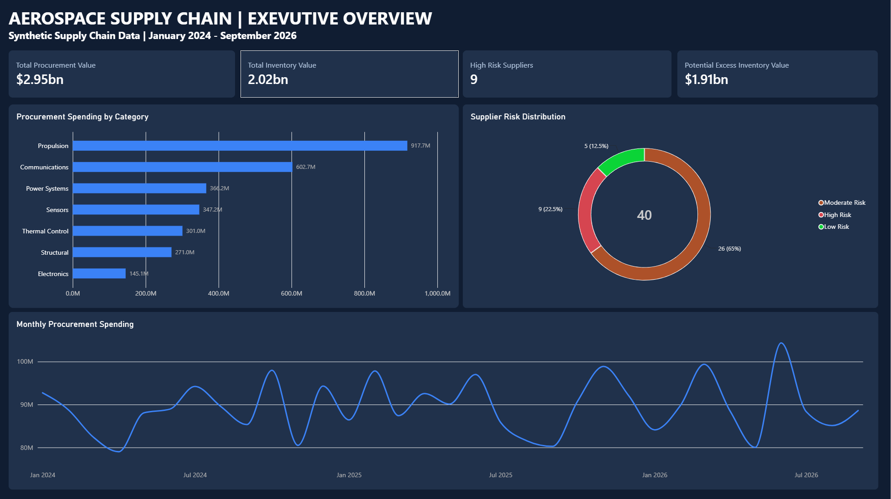
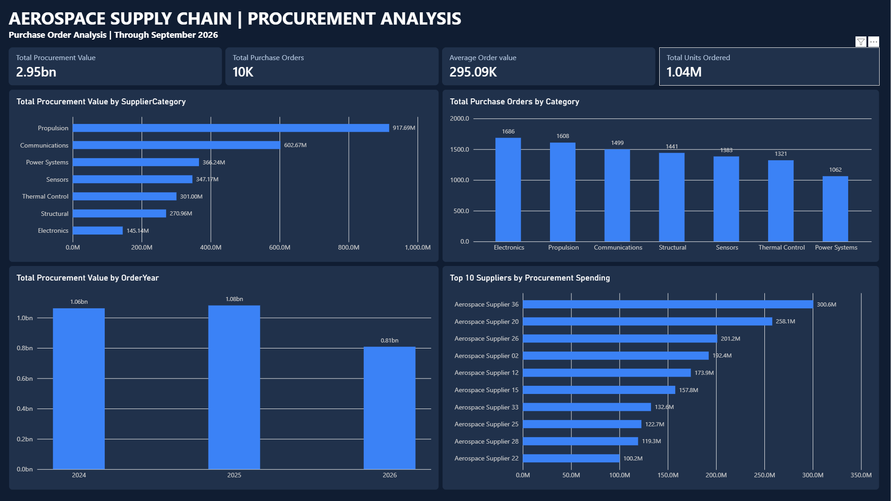
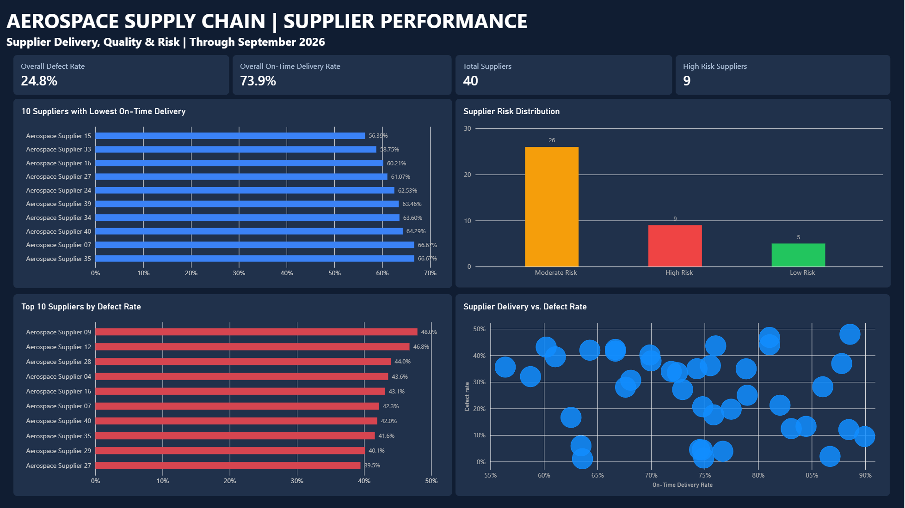
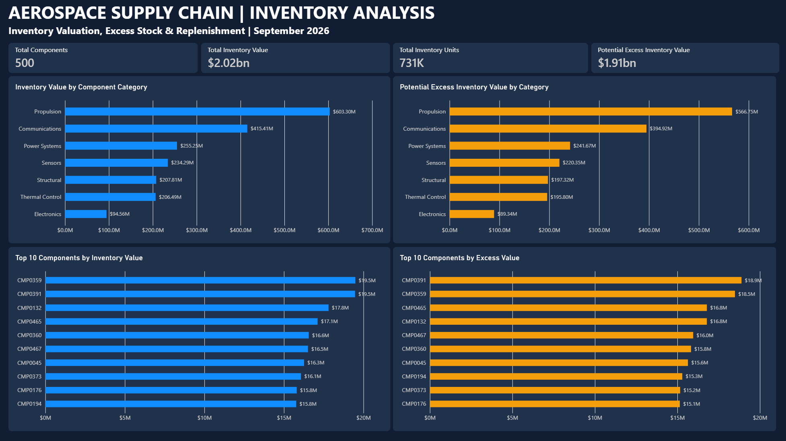
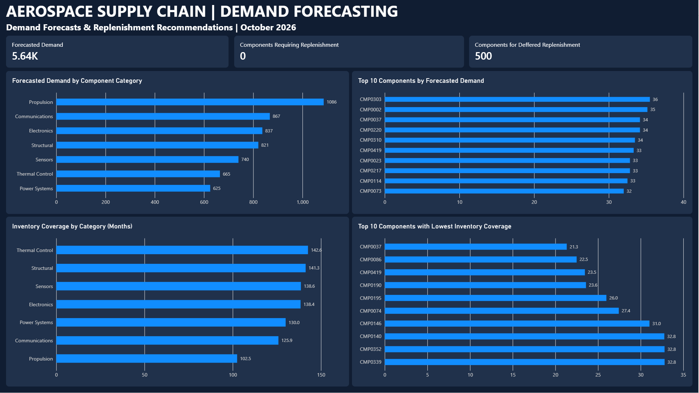

# Aerospace Supply Chain Analysis

## Project Overview

This project analyzes a simulated aerospace supply chain to evaluate procurement spending, supplier performance, inventory management, and demand forecasting.

Using Python, SQL, and Power BI, I developed an end-to-end analytics workflow that transforms synthetic supply chain data into actionable business insights.

The analysis focuses on identifying supplier delivery and quality risks, evaluating procurement spending patterns, estimating excess inventory exposure, and supporting inventory replenishment planning.

**Note:** All data in this project is synthetically generated for educational and portfolio purposes. The findings do not represent the operations of an actual aerospace company.

## Project Objectives

- **Procurement Analysis:** Examine purchasing trends, spending by category, and supplier spending concentration.
- **Supplier Performance:** Evaluate on-time delivery rates, defect rates, and supplier risk classifications.
- **Inventory Analysis:** Measure inventory value, identify components with high stock exposure, and estimate potential excess inventory.
- **Demand Forecasting:** Estimate future component demand using historical consumption patterns.
- **Business Intelligence:** Develop interactive Power BI dashboards that communicate supply chain performance and support data-driven decision-making.

## Technologies Used

- **Python:** Synthetic data generation, data cleaning, and analysis using pandas and NumPy.
- **SQLite / SQL:** Data storage, procurement analysis, supplier performance calculations, inventory analysis, and reporting views.
- **Power BI / DAX:** Data modeling, KPI calculations, and interactive dashboard development.
- **Jupyter Notebook:** Data exploration and validation.
- **Git & GitHub:** Version control and project documentation.

## Dataset Overview

The project uses five synthetically generated datasets representing different aspects of aerospace supply chain operations.

| Dataset | Records | Description |
|---|---:|---|
| Suppliers | 40 | Supplier information and classification |
| Components | 500 | Aerospace component information, categories, and pricing |
| Purchase Orders | 10,000 | Procurement transactions, quantities, costs, and order dates |
| Shipments | 10,000 | Shipment records used to evaluate delivery reliability and quality |
| Inventory Movements | 19,231 | Inventory transactions used to analyze stock levels and historical consumption |

The dataset covers procurement activity from January 2024 through September 2026, with October 2026 used as the next-month demand forecasting period.

All records were generated for simulation and educational analysis. They do not contain real company or supplier information.

## Project Methodology

### 1. Data Generation and Preparation

- Generated synthetic supply chain datasets using Python, pandas, and NumPy.
- Organized source data into raw and cleaned CSV files.
- Used Jupyter Notebook to inspect data structure, validate records, and prepare datasets for analysis.
- Created a SQLite database to store and query the supply chain data.

### 2. SQL Analysis

Developed SQL queries to analyze four major supply chain functions:

- **Procurement:** Purchase order activity, spending trends, supplier concentration, and component category spending.
- **Supplier Performance:** On-time delivery, defect rates, shipment activity, and supplier risk classification.
- **Inventory Management:** Current inventory, inventory valuation, safety stock, and estimated excess inventory.
- **Demand Forecasting:** Historical component consumption, moving-average forecasts, and replenishment recommendations.

Created six reporting views to support Power BI:

| SQL View | Purpose |
|---|---|
| `vw_supplier_performance` | Supplier delivery and quality metrics |
| `vw_supplier_risk` | Supplier risk classifications |
| `vw_inventory_valuation` | Component inventory quantities and values |
| `vw_excess_inventory` | Estimated inventory above modeled target levels |
| `vw_procurement` | Purchase order and spending analysis |
| `vw_demand_forecast` | Forecasted component demand and replenishment recommendations |

### 3. Demand Forecasting

Developed a six-month moving-average approach to estimate October 2026 component demand using historical inventory consumption.

The model produced an aggregate forecast of approximately **5,641 units** across 500 components.

A historical backtest produced an aggregate mean absolute percentage error (MAPE) of approximately **7.17%**. This aggregate result does not establish equivalent accuracy for individual component forecasts.

### 4. Power BI Dashboard Development

Imported the six SQL reporting views into Power BI and created relationships using supplier and component identifiers.

Developed DAX measures and five interactive dashboard pages:

1. Executive Overview
2. Procurement Analysis
3. Supplier Performance
4. Inventory Analysis
5. Demand Forecasting

The dashboards provide visibility into procurement spending, supplier reliability, quality performance, inventory exposure, and forecasted component demand.

### 5. Business Analysis

Interpreted the dashboard results to identify potential opportunities for:

- Improving supplier delivery reliability and component quality.
- Monitoring suppliers with elevated operational risk.
- Reviewing procurement spending concentration.
- Evaluating inventory levels against modeled targets.
- Supporting replenishment planning using historical demand patterns.

**Analytical limitations:** The dataset is synthetic, and its unusually high defect rates and inventory levels reflect simulation assumptions. Excess inventory estimates are not guaranteed financial savings, and replenishment recommendations require further validation against production requirements, supplier lead times, and demand uncertainty.

## Key Findings and Business Recommendations

### 1. Procurement Spending Analysis

**Key Findings:**
- Total procurement spending reached approximately **$2.95 billion** across 10,000 purchase orders.
- The average purchase order value was approximately **$295,088**.
- Propulsion components accounted for the highest procurement spending at approximately **$917.69 million**.
- Procurement spending increased approximately **1.8% from 2024 to 2025**.
- Spending during January–September 2026 totaled approximately **$808.26 million**, representing a partial year.

**Business Recommendations:**
- Prioritize spending reviews for high-value component categories, particularly Propulsion and Communications.
- Evaluate supplier concentration and identify opportunities for strategic sourcing or contract negotiations.
- Monitor monthly purchasing trends to identify unusual spending patterns.
- Use comparable reporting periods when evaluating year-over-year procurement performance.

### 2. Supplier Performance and Risk Analysis

**Key Findings:**
- Analyzed a network of **40 suppliers**.
- Overall on-time delivery performance was approximately **73.9%**.
- The overall shipment-weighted defect rate was approximately **24.8%**.
- Identified **9 high-risk suppliers**, representing **22.5%** of the supplier network.
- An additional **26 suppliers (65%)** were classified as moderate risk.
- Supplier 15 had the lowest observed on-time delivery rate at approximately **56.4%**.
- Supplier 09 had the highest observed defect rate at approximately **48.0%**.

**Business Recommendations:**
- Prioritize performance reviews for high-risk suppliers with poor delivery reliability and elevated defect rates.
- Establish supplier scorecards tracking delivery performance, quality, and shipment volume.
- Investigate recurring delivery delays and quality issues to identify their underlying causes.
- Consider alternative sourcing arrangements for critical components supplied by poorly performing vendors.
- Review moderate-risk suppliers regularly to identify deteriorating performance before they become high risk.

### 3. Inventory Valuation and Excess Stock Analysis

**Key Findings:**
- Analyzed **500 aerospace components** with approximately **731,052 units** in inventory.
- Total inventory value was approximately **$2.02 billion**.
- Estimated potential excess inventory value was approximately **$1.91 billion**.
- Approximately **94.5%** of inventory value exceeded the model's simplified target stock levels.
- Propulsion held the highest inventory value at approximately **$603.30 million**.
- Propulsion also had the highest modeled excess inventory exposure at approximately **$566.75 million**.
- Component CMP0391 had approximately **$18.9 million** in modeled excess inventory value.

**Business Recommendations:**
- Prioritize inventory reviews for high-value components with substantial modeled excess stock.
- Evaluate purchasing quantities against historical consumption and forecasted demand.
- Reassess safety stock assumptions, supplier lead times, and inventory targets.
- Investigate opportunities to reduce unnecessary inventory accumulation without increasing production or stockout risk.
- Treat modeled excess inventory as potential exposure requiring validation, not guaranteed recoverable savings.

### 4. Demand Forecasting and Replenishment Planning

**Key Findings:**
- Developed a six-month moving-average forecasting model using historical component consumption.
- Forecasted approximately **5,641 units** of component demand for October 2026.
- Propulsion had the highest category-level forecast at approximately **1,086 units**.
- Component CMP0303 had the highest individual forecast at approximately **36 units**.
- The model identified **0 components** requiring immediate replenishment review and **500 components** for deferred replenishment review.
- Overall inventory coverage was approximately **129.6 months** at the modeled monthly demand rate.
- Component CMP0037 had the lowest estimated inventory coverage at approximately **21.3 months**.

**Business Recommendations:**
- Use demand forecasts alongside inventory levels to support replenishment planning.
- Review components with the lowest inventory coverage first, while accounting for criticality and supplier lead times.
- Investigate the unusually high inventory coverage suggested by the synthetic dataset.
- Validate forecast accuracy at the component level before relying on predictions for operational decisions.
- Incorporate production schedules, demand variability, and lead-time requirements into future forecasting and replenishment models.

## Overall Business Conclusion

The analysis highlights opportunities to improve supply chain visibility, supplier risk management, procurement oversight, and inventory planning.

The most significant findings involve elevated supplier quality and delivery risks, substantial modeled excess inventory exposure, and unusually high inventory coverage relative to forecasted consumption.

A practical improvement strategy would prioritize supplier performance reviews, targeted inventory assessments, and more detailed demand planning.

**Important:** All results are based on synthetic data. Financial values, supplier performance rates, and replenishment recommendations are simulated analytical outputs and should not be interpreted as actual aerospace industry benchmarks or guaranteed business outcomes.

## Power BI Dashboards

Developed five interactive Power BI dashboard pages to analyze procurement activity, supplier performance, inventory management, and demand forecasting.

### 1. Executive Overview

Provides a high-level summary of procurement spending, inventory valuation, supplier risk, and purchasing trends.

### 2. Procurement Analysis

Examines procurement spending by supplier and category, purchase order activity, and annual purchasing trends.

### 3. Supplier Performance

Evaluates supplier delivery reliability, defect rates, risk classifications, and relationships between delivery performance and quality.

### 4. Inventory Analysis

Visualizes inventory value, estimated excess stock, component-level inventory exposure, and category-level inventory distribution.

### 5. Demand Forecasting

Displays forecasted component demand, replenishment recommendations, inventory coverage, and components with the lowest estimated stock coverage.

### Power BI Report

The complete interactive Power BI report is available in the `dashboard/` folder.

Open the `.pbix` file using Power BI Desktop to explore all five dashboard pages.